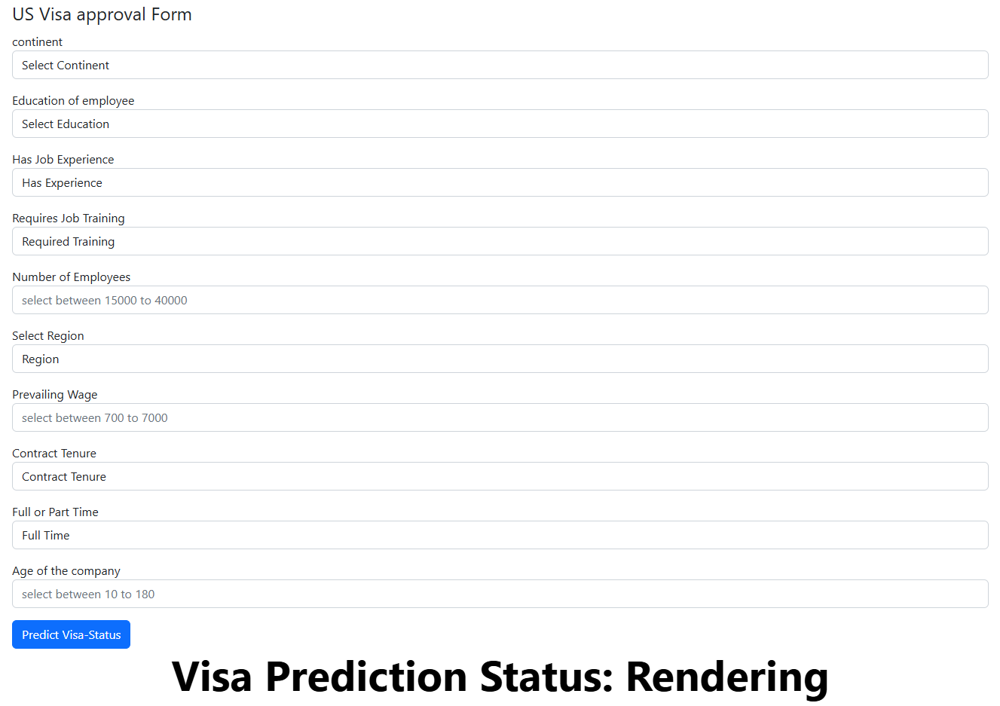
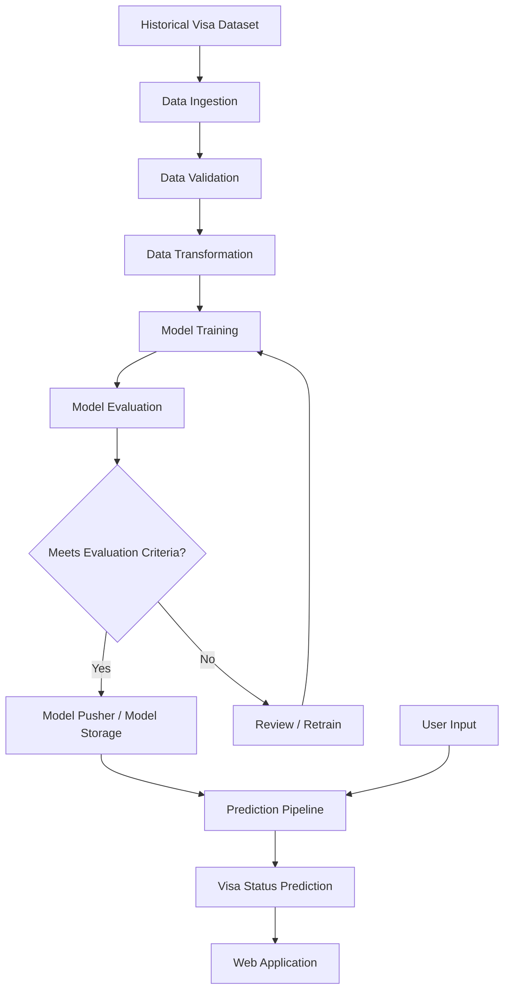
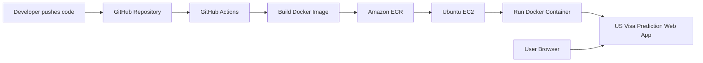

# 🇺🇸 US Visa Approval Prediction | End-to-End MLOps Project

<p align="center">
  <strong>An end-to-end Machine Learning application for predicting US visa application outcomes</strong><br/>
  <em>From data ingestion and validation to model training, cloud storage, Dockerization, and AWS CI/CD deployment.</em>
</p>

<p align="center">
  
  
  
  
  
  
  
</p>

---

## 📌 Project Overview

The **US Visa Approval Prediction** project is an end-to-end Machine Learning and MLOps implementation designed to estimate whether a US employment-based visa application is likely to be certified or denied, based on employer and job-related information.

The project demonstrates how a machine learning solution can be structured beyond experimentation: data is ingested, validated against a schema, transformed, used for model training and evaluation, and then made available through a web application. The implementation also includes integrations and deployment components for MongoDB, AWS, Docker, and CI/CD.

> **Important:** This is an educational machine learning prediction system. Its output is not an official US government decision, legal advice, or a guarantee of visa approval. Actual decisions are made by the relevant authorities.

## 🎯 Business Problem

Employers submitting employment-based visa applications need to understand factors associated with certification outcomes. Historical application data can be explored to identify patterns and train a classification model.

This project frames the task as a **binary classification problem**:

- **Input:** Employer, employee, job, wage, location, and employment-related attributes.
- **Output:** A model-predicted visa application status (for example, Certified or Denied, depending on the labels used in the training dataset).

### Project objectives

- Build a repeatable end-to-end ML workflow.
- Validate incoming data before model training.
- Apply consistent preprocessing and feature transformation.
- Train and evaluate classification models.
- Persist and retrieve data/model artifacts using configured storage services.
- Serve predictions through a user-friendly web interface.
- Package the application with Docker.
- Support automated deployment through GitHub Actions and AWS.

## 🖥️ Application Preview

The web application accepts employer and job-related details and returns a model-generated visa status prediction.

<p align="center">
  
</p>

### Input features shown in the application

| Feature | Description |
|---|---|
| Continent | Continent associated with the employee |
| Education of Employee | Employee's education level |
| Has Job Experience | Whether the employee has prior job experience |
| Requires Job Training | Whether the job requires training |
| Number of Employees | Employer's employee count |
| Select Region | Geographic region of employment |
| Prevailing Wage | Wage offered for the position |
| Contract Tenure | Employment contract duration |
| Full or Part Time | Employment schedule |
| Age of the Company | Company's age |

The input values must follow the ranges and categories configured by the application and model pipeline. The screenshot documents the interface; it does not imply that every possible input combination is valid.

## 🧠 Machine Learning Approach

This is a supervised **classification** use case. The model learns relationships between historical application attributes and their target labels.

Typical stages in the workflow:

1. **Data ingestion** – collect source records and make them available to the pipeline.
2. **Data validation** – check incoming data against the configured schema.
3. **Data transformation** – handle categorical/numerical features and prepare model-ready data.
4. **Model training** – train candidate classification models using the transformed data.
5. **Model evaluation** – evaluate model performance against configured evaluation criteria.
6. **Model pushing** – persist or publish an accepted model artifact to the configured storage location.
7. **Prediction** – load the trained estimator, transform user input consistently, and return a prediction.

### High-level architecture



### MLOps workflow layers

| Layer | Responsibility |
|---|---|
| Constants | Shared names, paths, configuration keys, and project-wide constants |
| Entity | Configuration and artifact data structures passed between pipeline stages |
| Components | Individual ingestion, validation, transformation, training, evaluation, and model-pushing tasks |
| Configuration | Connections to external services such as MongoDB and AWS |
| Data Access | Reading and writing project data |
| Pipeline | Orchestrating training and prediction stages |
| Utilities | Reusable helper functions for serialization, data handling, and common operations |
| Application | Collecting user input and presenting predictions |

## 🛠️ Technology Stack

| Category | Technology | Purpose |
|---|---|---|
| Language | Python | Application and ML implementation |
| Data processing | Pandas, NumPy | Data manipulation and numerical operations |
| Machine Learning | Scikit-learn | Preprocessing and classification |
| Web application | Flask / HTML / CSS | Prediction interface |
| Database | MongoDB | Configured data storage and retrieval |
| Cloud storage | AWS S3 | Configured storage for model artifacts |
| Cloud infrastructure | AWS EC2 | Hosting the containerized application |
| Containerization | Docker | Reproducible application packaging |
| Container registry | AWS ECR | Storing and retrieving Docker images |
| CI/CD | GitHub Actions | Automated build and deployment workflow |
| Model monitoring / data quality | Evidently AI (where configured) | Data quality and drift analysis |

> The exact libraries and integrations available at runtime depend on the repository's `requirements.txt` and configuration. Review those files if you change the environment or deployment setup.

---

## 📂 Repository Structure

The following describes the project layout used by the reference implementation. If your local fork has renamed or added files, keep the descriptions aligned with the actual checked-in tree.

```text
MLOPs-Production-Ready-Machine-Learning-Project/
│
├── .github/
│   └── workflows/
│       └── aws.yaml                 # GitHub Actions AWS deployment workflow
│
├── config/
│   ├── model.yaml                   # Model and training configuration
│   └── schema.yaml                  # Dataset schema and validation rules
│
├── flowcharts/                      # Visual diagrams of pipeline components
│
├── notebook/
│   ├── 1_EDA_US_visa.ipynb          # Exploratory data analysis
│   ├── 2_Feature_Engineering_and_Model_Training.ipynb
│   ├── data_drift_demo_evidently.ipynb
│   ├── mongodb_demo.ipynb
│   └── Visadataset.csv              # Dataset, if included in the repository
│
├── static/
│   └── css/
│       └── style.css                # Web application styling
│
├── templates/
│   └── usvisa.html                  # Visa prediction form / result page
│
├── us_visa/
│   ├── cloud_storage/
│   │   └── aws_storage.py           # AWS S3 storage operations
│   │
│   ├── components/
│   │   ├── data_ingestion.py        # Data ingestion stage
│   │   ├── data_validation.py       # Schema and data validation
│   │   ├── data_transformation.py   # Feature preprocessing
│   │   ├── model_trainer.py         # Model training
│   │   ├── model_evaluation.py      # Model evaluation
│   │   └── model_pusher.py          # Persist / push accepted model
│   │
│   ├── configuration/
│   │   ├── aws_connection.py        # AWS connection configuration
│   │   └── mongo_db_connection.py   # MongoDB connection configuration
│   │
│   ├── constants/                   # Shared project constants
│   ├── data_access/
│   │   └── usvisa_data.py           # Dataset access layer
│   │
│   ├── entity/
│   │   ├── artifact_entity.py       # Artifact metadata structures
│   │   ├── config_entity.py         # Component configuration structures
│   │   ├── estimator.py             # Model estimator wrapper
│   │   └── s3_estimator.py          # S3-backed estimator support
│   │
│   ├── exception/                   # Custom exception handling
│   ├── logger/                      # Centralized logging
│   ├── pipline/
│   │   ├── training_pipeline.py     # End-to-end training orchestration
│   │   └── prediction_pipeline.py   # Prediction orchestration
│   │
│   └── utils/
│       └── main_utils.py            # Reusable utility functions
│
├── app.py                           # Web application entry point
├── demo.py                          # Training / pipeline execution entry point
├── template.py                      # Project structure / template utility
├── setup.py                         # Python package setup
├── requirements.txt                 # Python dependencies
├── Dockerfile                       # Docker image instructions
├── .dockerignore                    # Files excluded from Docker build context
├── .gitignore                       # Files excluded from Git
├── LICENSE
└── README.md
```

### Important configuration files

- **`config/schema.yaml`** – describes expected dataset columns, types, and validation constraints.
- **`config/model.yaml`** – stores model-related configuration used by the training workflow.
- **`requirements.txt`** – defines the Python packages needed by the project.
- **`setup.py`** – enables installation of the project as a Python package.
- **`Dockerfile`** – defines how the application image is built.
- **`.github/workflows/aws.yaml`** – contains the CI/CD workflow, if configured in the repository.

---

## ⚙️ Getting Started — Local Setup

### 1. Prerequisites

Install the following before running the project:

- Git
- Python (use the version supported by the project's dependencies; the reference setup uses Python 3.8)
- Conda or Python virtual environment
- MongoDB connection, if database-backed ingestion is enabled
- AWS account and credentials, if S3 functionality is enabled
- Docker, if you want to run the containerized version

### 2. Clone the repository

```bash
git clone https://github.com/tusharaitechie/MLOPs-Production-Ready-Machine-Learning-Project.git
cd MLOPs-Production-Ready-Machine-Learning-Project
```

### 3. Create and activate a Conda environment

```bash
conda create -n visa python=3.8 -y
conda activate visa
```

If you use `venv` instead:

**Windows PowerShell**
```powershell
py -3.8 -m venv venv
.\venv\Scripts\Activate.ps1
```

**Linux / macOS**
```bash
python3 -m venv venv
source venv/bin/activate
```

### 4. Install dependencies

```bash
python -m pip install --upgrade pip
pip install -r requirements.txt
```

Install the project in editable mode if package imports require it:

```bash
pip install -e .
```

### 5. Configure environment variables

The application may use MongoDB and AWS depending on the enabled pipeline components. Configure credentials through environment variables rather than hardcoding them in source files.

**Windows PowerShell**
```powershell
$env:MONGODB_URL="mongodb+srv://<username>:<password>@<cluster-url>/<database>"
$env:AWS_ACCESS_KEY_ID="<your-access-key-id>"
$env:AWS_SECRET_ACCESS_KEY="<your-secret-access-key>"
$env:AWS_DEFAULT_REGION="us-east-1"
```

**Linux / macOS**
```bash
export MONGODB_URL="mongodb+srv://<username>:<password>@<cluster-url>/<database>"
export AWS_ACCESS_KEY_ID="<your-access-key-id>"
export AWS_SECRET_ACCESS_KEY="<your-secret-access-key>"
export AWS_DEFAULT_REGION="us-east-1"
```

Replace all placeholders with your own values. Do not commit credentials, `.env` files, access keys, or database connection strings to GitHub.

If your project uses a `.env` file, keep it out of version control and load it using the mechanism already implemented in the application.

### 6. Run the training pipeline

The reference project exposes `demo.py` as its pipeline/demo entry point. Run:

```bash
python demo.py
```

This is expected to execute the training workflow wired into that entry point. Review `demo.py` before running it to confirm whether it triggers ingestion, training, evaluation, and model pushing in your current checkout.

### 7. Start the web application

```bash
python app.py
```

Open the local URL printed by Flask in the terminal. In the reference implementation the application is commonly served on port `8080`:

```text
http://127.0.0.1:8080
```

If the application binds to `0.0.0.0`, use `127.0.0.1` in your local browser. Confirm the actual host and port in `app.py`.

---

## 🔄 Understanding the Pipeline Components

### 1. Data Ingestion

The ingestion stage obtains source records and prepares them for downstream processing. It can use the configured MongoDB data-access layer.

**Responsibilities**
- Connect to the configured data source.
- Read the visa application records.
- Create an ingestion artifact for later stages.
- Keep the source-data handling separate from model code.

### 2. Data Validation

The validation stage checks whether the ingested dataset conforms to the expected schema.

**Responsibilities**
- Check required columns.
- Validate expected data types and schema constraints.
- Detect missing or unexpected fields.
- Produce validation results / artifacts for downstream stages.

### 3. Data Transformation

The transformation stage converts raw records into features suitable for machine learning.

**Typical responsibilities**
- Separate input features and target labels.
- Handle categorical and numerical columns.
- Apply the configured preprocessing operations.
- Persist the fitted preprocessing object when required.
- Ensure training and inference use compatible transformations.

### 4. Model Training

The training stage fits the configured classification estimator using transformed training data.

**Responsibilities**
- Load transformed training data.
- Fit the configured model.
- Save the trained estimator and training artifacts.
- Keep model configuration separate from pipeline orchestration.

### 5. Model Evaluation

The evaluation stage measures model quality and checks the candidate model against the configured acceptance criteria.

Common classification metrics include:

- Accuracy
- Precision
- Recall
- F1-score
- Confusion matrix
- ROC-AUC, when appropriate for the model and evaluation setup

The exact metric and acceptance threshold should be read from the project's evaluation implementation and configuration; no unverified score is claimed here.

### 6. Model Pusher and Cloud Storage

The model-pushing stage makes the accepted model artifact available to the configured storage location. The project includes AWS storage / estimator modules in the reference layout.

**Typical responsibilities**
- Serialize the accepted estimator and preprocessing artifacts.
- Upload or persist artifacts to the configured location.
- Make the model available to the prediction pipeline.

### 7. Prediction Pipeline

The prediction pipeline accepts new application records, applies the same preprocessing used during training, loads the model, and returns a predicted class.

### 8. Logging and Exception Handling

Centralized logging and custom exception modules help record pipeline activity and make failures easier to diagnose.

---

## 🐳 Docker — Build and Run

### 1. Build the Docker image

Run this command from the repository root (where the `Dockerfile` is located):

```bash
docker build -t us-visa-prediction:latest .
```

### 2. Verify the image

```bash
docker images
```

### 3. Run the container

```bash
docker run -d \
  --name us-visa-prediction \
  -p 8080:8080 \
  us-visa-prediction:latest
```

For a service that needs MongoDB / AWS configuration, pass environment variables securely at runtime. For example:

```bash
docker run -d \
  --name us-visa-prediction \
  -p 8080:8080 \
  -e MONGODB_URL="$MONGODB_URL" \
  -e AWS_DEFAULT_REGION="$AWS_DEFAULT_REGION" \
  us-visa-prediction:latest
```

Provide AWS credentials through an IAM role where possible rather than embedding long-lived keys in an image or command history.

### 4. Check container logs and status

```bash
docker ps
docker logs -f us-visa-prediction
```

### 5. Stop and remove the container

```bash
docker stop us-visa-prediction
docker rm us-visa-prediction
```

### 6. Remove the local image (optional)

```bash
docker rmi us-visa-prediction:latest
```

> The container port must match the port exposed by the Flask application and configured in the Dockerfile. If your app uses a different port, update the `-p` mapping accordingly.

---

# ☁️ AWS Deployment — ECR + EC2

This section documents a practical deployment flow based on the AWS approach in the reference repository: build a Docker image, push it to Amazon ECR, then pull and run it on an Ubuntu EC2 instance. The GitHub Actions section below explains how to automate the process.

## Deployment architecture



## Step 1 — Create AWS resources

You need:

1. An AWS account.
2. An IAM identity for deployment.
3. An Amazon ECR repository.
4. An Ubuntu EC2 instance.
5. A security group that permits the application port from trusted sources.

### IAM permissions

For a learning setup, the reference repository mentions these managed policies:

- `AmazonEC2ContainerRegistryFullAccess`
- `AmazonEC2FullAccess`

For a real production deployment, prefer least-privilege custom policies and an EC2 instance role. Avoid broad permissions when narrower ECR push/pull and required EC2 permissions are sufficient.

Create an IAM access key only if your CI/CD design requires one. Never paste the key into source code or commit it to Git.

## Step 2 — Create an ECR repository

1. Open the AWS Console.
2. Navigate to **Amazon Elastic Container Registry (ECR)**.
3. Choose **Create repository**.
4. Set the repository name, for example:

```text
us-visa-prediction
```

5. Keep the repository visibility as private unless you have a specific reason to publish it.
6. Create the repository.
7. Copy the repository URI.

The URI has this format:

```text
<AWS_ACCOUNT_ID>.dkr.ecr.<AWS_REGION>.amazonaws.com/us-visa-prediction
```

Set placeholders for your own account and region. Do not reuse another person's ECR URI.

## Step 3 — Install and configure AWS CLI locally

Install AWS CLI v2, then verify:

```bash
aws --version
```

Configure credentials if you are using an IAM user locally:

```bash
aws configure
```

Enter your access key, secret key, default region, and output format when prompted. Prefer IAM Identity Center or role-based credentials where available.

Verify the active identity:

```bash
aws sts get-caller-identity
```

## Step 4 — Authenticate Docker with Amazon ECR

**Linux / macOS / Git Bash**
```bash
aws ecr get-login-password --region <AWS_REGION> \
  | docker login --username AWS --password-stdin \
  <AWS_ACCOUNT_ID>.dkr.ecr.<AWS_REGION>.amazonaws.com
```

**PowerShell**
```powershell
aws ecr get-login-password --region <AWS_REGION> |
  docker login --username AWS --password-stdin <AWS_ACCOUNT_ID>.dkr.ecr.<AWS_REGION>.amazonaws.com
```

## Step 5 — Build, tag, and push the image

Run from the project root:

```bash
docker build -t us-visa-prediction:latest .
```

Set the registry and repository values (replace placeholders):

```bash
export AWS_ACCOUNT_ID="<AWS_ACCOUNT_ID>"
export AWS_REGION="<AWS_REGION>"
export ECR_REPOSITORY="us-visa-prediction"
export ECR_URI="${AWS_ACCOUNT_ID}.dkr.ecr.${AWS_REGION}.amazonaws.com/${ECR_REPOSITORY}"
```

For PowerShell:

```powershell
$AWS_ACCOUNT_ID="<AWS_ACCOUNT_ID>"
$AWS_REGION="<AWS_REGION>"
$ECR_REPOSITORY="us-visa-prediction"
$ECR_URI="$AWS_ACCOUNT_ID.dkr.ecr.$AWS_REGION.amazonaws.com/$ECR_REPOSITORY"
```

Tag and push:

```bash
docker tag us-visa-prediction:latest <AWS_ACCOUNT_ID>.dkr.ecr.<AWS_REGION>.amazonaws.com/us-visa-prediction:latest
docker push <AWS_ACCOUNT_ID>.dkr.ecr.<AWS_REGION>.amazonaws.com/us-visa-prediction:latest
```

Confirm that the image appears in the ECR repository's **Images** tab.

## Step 6 — Launch an Ubuntu EC2 instance

1. Open **Amazon EC2** in the AWS Console.
2. Launch an Ubuntu Server instance.
3. Choose an instance type suitable for your expected workload.
4. Configure an SSH key pair.
5. Attach an IAM instance role with permission to pull from the required ECR repository.
6. Configure the security group:
   - SSH (`22`) only from your trusted IP.
   - Application port (`8080`, if that is the port used by the app) only from the required client IP ranges.
7. Launch the instance.

For production, put the application behind HTTPS using a reverse proxy or load balancer. Do not expose development services or unrestricted SSH access to the public internet.

## Step 7 — Connect to EC2 and install Docker

Connect using your downloaded key:

```bash
ssh -i <your-key.pem> ubuntu@<EC2_PUBLIC_IP>
```

Update the package index and install Docker:

```bash
sudo apt-get update -y
sudo apt-get upgrade -y

curl -fsSL https://get.docker.com -o get-docker.sh
sudo sh get-docker.sh

sudo usermod -aG docker ubuntu
newgrp docker
```

Verify:

```bash
docker --version
docker ps
```

## Step 8 — Pull the ECR image on EC2

The EC2 instance should use its attached IAM role for AWS permissions.

```bash
aws --version
aws sts get-caller-identity
```

If AWS CLI is not installed, install AWS CLI v2 using the official AWS installation instructions for Ubuntu.

Authenticate and pull:

```bash
aws ecr get-login-password --region <AWS_REGION> \
  | docker login --username AWS --password-stdin \
  <AWS_ACCOUNT_ID>.dkr.ecr.<AWS_REGION>.amazonaws.com

docker pull <AWS_ACCOUNT_ID>.dkr.ecr.<AWS_REGION>.amazonaws.com/us-visa-prediction:latest
```

## Step 9 — Run the application on EC2

```bash
docker run -d \
  --restart unless-stopped \
  --name us-visa-prediction \
  -p 8080:8080 \
  <AWS_ACCOUNT_ID>.dkr.ecr.<AWS_REGION>.amazonaws.com/us-visa-prediction:latest
```

Check the container:

```bash
docker ps
docker logs -f us-visa-prediction
```

Open the application using:

```text
http://<EC2_PUBLIC_IP>:8080
```

This HTTP URL is for a basic test only. Configure HTTPS and a domain name before exposing a production application.

### Update an existing deployment

After pushing a new image to ECR:

```bash
docker pull <AWS_ACCOUNT_ID>.dkr.ecr.<AWS_REGION>.amazonaws.com/us-visa-prediction:latest

docker stop us-visa-prediction
docker rm us-visa-prediction

docker run -d \
  --restart unless-stopped \
  --name us-visa-prediction \
  -p 8080:8080 \
  <AWS_ACCOUNT_ID>.dkr.ecr.<AWS_REGION>.amazonaws.com/us-visa-prediction:latest
```

---

## 🔁 CI/CD — GitHub Actions with AWS

The reference deployment design uses GitHub Actions to automate Docker image creation and deployment to AWS. The workflow file in the reference layout is `.github/workflows/aws.yaml`.

### CI/CD flow

1. Developer pushes changes to the configured GitHub branch.
2. GitHub Actions starts the workflow.
3. The runner checks out the source code.
4. Docker builds the application image.
5. The workflow authenticates with AWS.
6. The image is tagged and pushed to ECR.
7. The deployment target pulls the latest image and starts the container.

### Step 1 — Configure a GitHub Actions runner

The reference setup uses an EC2-hosted self-hosted runner.

1. Open your GitHub repository.
2. Navigate to **Settings → Actions → Runners**.
3. Select **New self-hosted runner**.
4. Choose Linux and the appropriate architecture.
5. Follow the commands GitHub generates for downloading, configuring, and registering the runner.
6. Run the generated commands on the EC2 machine.
7. Confirm that the runner appears as **Idle** / online in GitHub.

Use the exact registration commands generated by GitHub for your repository. Runner registration tokens are temporary and must not be committed.

### Step 2 — Add GitHub repository secrets

Navigate to:

**Repository → Settings → Secrets and variables → Actions → New repository secret**

Create the secrets expected by your workflow. The reference naming is:

| Secret | Value |
|---|---|
| `AWS_ACCESS_KEY_ID` | IAM access key ID, if using access keys |
| `AWS_SECRET_ACCESS_KEY` | IAM secret access key, if using access keys |
| `AWS_DEFAULT_REGION` | AWS region, for example `us-east-1` |
| `ECR_REPO` | ECR repository URI or value expected by the workflow |

> **Important:** Secret names must match the expressions used in `.github/workflows/aws.yaml`. Some workflows expect a registry URI and repository name as separate values. Open your workflow file and verify the exact names and expected formats before creating secrets.

Never print secrets in workflow logs. Prefer short-lived credentials through GitHub OIDC and an AWS IAM role over long-lived IAM user keys when the workflow supports it.

### Step 3 — Verify the workflow configuration

Review `.github/workflows/aws.yaml` and confirm:

- The trigger branch matches your repository's default branch.
- The runner label matches the runner you registered.
- AWS region and ECR repository values are configured.
- The Docker build context and Dockerfile path are correct.
- The image tag is consistent between push and deployment.
- The EC2 deployment commands stop the previous container and start the new image.
- Required environment variables are provided securely at runtime.

### Step 4 — Trigger deployment

Push a change to the configured branch:

```bash
git add .
git commit -m "Update visa prediction application"
git push origin main
```

Then open the **Actions** tab in GitHub and inspect the workflow run. Confirm that the image is pushed to ECR and that the EC2 application is running.

---

## 🧪 Development and Git Commands

### Check repository status

```bash
git status
```

### Stage changes

```bash
git add .
```

### Commit changes

```bash
git commit -m "Improve US visa prediction pipeline"
```

### Push to GitHub

```bash
git push origin main
```

### Pull latest changes

```bash
git pull origin main
```

### Create and switch to a feature branch

```bash
git checkout -b feature/update-prediction-ui
```

### Push a feature branch

```bash
git push -u origin feature/update-prediction-ui
```

### Recommended `.gitignore` entries

Keep generated environments, credentials, and local artifacts out of source control. Adapt these patterns to the paths used in your repository:

```gitignore
# Python
__pycache__/
*.py[cod]
*.pyo
*.pyd

# Virtual environments
venv/
.venv/
env/

# Secrets
.env
.env.*
!.env.example

# Jupyter
.ipynb_checkpoints/

# Generated artifacts and logs (adjust if tracked intentionally)
logs/
artifact/
artifacts/
*.log

# OS / IDE
.DS_Store
.vscode/
.idea/
```

Do not ignore model or configuration files that are intentionally required to reproduce the project. Review the existing `.gitignore` before replacing it.

---

## 🔍 Troubleshooting

| Issue | Possible reason | What to check |
|---|---|---|
| `ModuleNotFoundError` | Environment or package setup issue | Activate the correct environment and install `requirements.txt`; verify `pip install -e .` if needed |
| MongoDB connection failure | Invalid URI, network access, or database permissions | Check `MONGODB_URL`, database user, cluster network rules, and connectivity |
| AWS authentication error | Missing or expired credentials / role permissions | Run `aws sts get-caller-identity` and review IAM permissions |
| ECR login failure | Incorrect region or registry URI | Ensure the ECR registry and CLI region match |
| Docker build failure | Missing files or incorrect build context | Run the build from the directory containing the Dockerfile; inspect `.dockerignore` |
| Container exits immediately | Application startup error or missing environment variables | Run `docker logs <container-name>` |
| Browser cannot reach EC2 app | Container port or security group mismatch | Check `docker ps`, Flask bind address, port mapping, and inbound rules |
| GitHub Actions runner offline | Runner service stopped or registration issue | Check runner status and restart the runner service |
| Workflow cannot push to ECR | Missing secret, wrong secret format, or insufficient IAM permissions | Compare workflow secret references with repository secrets and IAM policy |

---

## 🔐 Security and Production Considerations

- Never commit AWS access keys, MongoDB credentials, private keys, or `.env` files.
- Use IAM roles and least-privilege permissions wherever possible.
- Keep SSH access restricted to trusted IP addresses.
- Do not expose MongoDB publicly; configure network access carefully.
- Use HTTPS for public deployments.
- Pin and review dependency versions.
- Validate input data before passing it to the prediction pipeline.
- Monitor application logs and deployment failures.
- Version model artifacts and retain a known-good model for rollback.
- Treat predictions as decision-support signals, not official immigration outcomes.

## 🚀 Potential Enhancements

The project can be extended further with:

- Unit and integration tests for each pipeline component.
- Automated data-quality and drift reports.
- Model version tracking and experiment management.
- A model performance dashboard.
- API endpoints for programmatic predictions.
- Structured application logging and monitoring.
- Automated rollback and health checks in deployment.
- HTTPS, domain configuration, and production-grade secrets management.

## 👨‍💻 Author

**Tushar Nile**

Machine Learning | Data Science | MLOps | Generative AI

- GitHub: [@tusharaitechie](https://github.com/tusharaitechie)
- Project Repository: [MLOPs-Production-Ready-Machine-Learning-Project](https://github.com/tusharaitechie/MLOPs-Production-Ready-Machine-Learning-Project)

---

<p align="center">
  <strong>Built to demonstrate the complete journey from a Machine Learning model to a deployable application.</strong>
</p>
